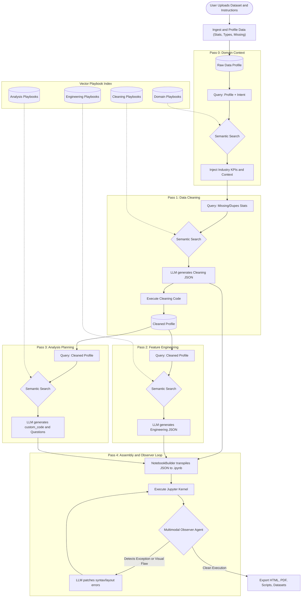

# ⚡ First Pass: Autonomous Agentic RAG Data Scientist

[](https://www.python.org/downloads/)
[](https://nourian.dev/projects#first-pass)
[](https://cloud.google.com/run)
[](https://deepmind.google/technologies/gemini/)
[-10B981)](#📊-evaluation-benchmarks--production-observability)
[](#📊-evaluation-benchmarks--production-observability)

**First Pass** is an autonomous AI data scientist designed to automate the heavy lifting of exploratory data analysis (EDA). Built with a specialized **5-pass Agentic RAG architecture**, the system dynamically ingests raw datasets, retrieves domain-specific analysis strategies from a hybrid BM25 + FAISS playbook index, transpiles structured JSON plans into executable Jupyter Notebooks, and supervises execution with a self-correcting **Multimodal Vision-Language Observer loop**.

Validated across a **5-domain benchmark suite (121,850 rows, 87 columns)** via an automated evaluation harness (`evaluate.py`), First Pass achieves a **100.0% post-Observer code cell execution rate (0% unhandled failure rate)**, **74.3 ms p50 profiling latency**, and an average end-to-end API cost of **$0.0232 per run**.

---

## 🎯 Key Capabilities

* **Hybrid Agentic Playbook RAG:** Dynamically maps your dataset's statistical profile to a 25-playbook knowledge base using combined lexical (`BM25Okapi`) and dense vector (`FAISS IndexFlatIP`) retrieval across 67 registered code templates.
* **Autonomous Notebook Compilation:** A custom `NotebookBuilder` engine transpiles LLM-generated, Pydantic-validated JSON execution plans directly into executable `.ipynb` files.
* **Multimodal Self-Correction (Observer Loop):** An integrated Vision-Language Observer agent inspects rendered PNG charts and cell tracebacks in a headless Jupyter kernel, iteratively patching Python runtime exceptions (`TypeError`, `KeyError`) and visual layout flaws (occluded legends, dual-axis grid collisions) on the fly.
* **Automated Evaluation & Production Telemetry:** Includes a 5-tier evaluation harness (`evaluate.py` & `pytest`) benchmarking profiling latency, RAG retrieval MRR, schema compliance, Observer self-correction deltas, and structured runtime telemetry (`telemetry.jsonl`).
* **Zero-Configuration UI & Cloud Run Deployment:** A Streamlit interface offering multi-format data ingestion (`.csv`, `.parquet`, `.xlsx`, `.xls`) and instant reporting exports (`.ipynb`, `.py`, `.html`, `.pdf`, `.docx`), containerized on Google Cloud Run.

---

## 🧠 System Architecture

First Pass operates on a sequential, multi-agent pipeline designed to mimic the workflow of a senior data scientist:

1. **Pass 0 (Domain Context):** Injects industry-specific KPIs and best practices based on the dataset's initial statistical profile.
2. **Pass 1 (Data Cleaning):** Intelligently handles missing values, standardizes types, deduplicates records, and parses mixed-format dates in-memory.
3. **Pass 2 (Feature Engineering):** Mathematically transforms features (e.g., binning, standard scaling, temporal extraction) to surface deeper signals.
4. **Pass 3 (Analysis Planning):** Formulates targeted business questions and generates consultant-grade Matplotlib/Seaborn Python code using retrieved templates and bespoke `custom_code` synthesis.
5. **Pass 4 (Multimodal Observer & Synthesis Loop):** Safely executes the compiled notebook in a headless Jupyter kernel, utilizing a multimodal vision observer to catch and resolve tracebacks or visual layout flaws before synthesizing executive takeaways and cell-level interpretations.

<details open>
<summary><b>View Pipeline Schematic</b></summary>


</details>

---

## 📊 Evaluation Benchmarks & Production Observability

First Pass includes a reproducible, 5-tier evaluation harness (`first_pass/eval_harness.py` & `evaluate.py`) and structured runtime telemetry (`first_pass/telemetry.py` & `telemetry.jsonl`) to continuously audit latency, token cost, retrieval precision, schema adherence, and execution failure rates across **5 diverse real-world datasets totaling 121,850 rows and 87 columns**.

### 1. Executive Benchmark Summary

| Evaluation Dimension | Metric | Benchmark Result | Notes / Methodology |
| :--- | :--- | :--- | :--- |
| **Statistical Profiling** | **Latency (p50 / Mean / Max)** | **74.3 ms / 345.1 ms / 1,425.8 ms** | Across 49 to 69,366 rows (121,850 total rows) |
| **Type Inference** | **Schema Type Accuracy** | **100.0%** | Ground-truth checks across `numeric`, `categorical`, `datetime`, `boolean`, `id_like`, `free_text` |
| **Hybrid Playbook RAG** | **Hit@1 / Recall@3 / MRR** | **100.0% / 100.0% / 1.0000 MRR** | 50% `BM25Okapi` + 50% `FAISS IndexFlatIP` across 25 playbooks (10 golden queries) |
| **Planner Compliance** | **Schema & Template Validity** | **100.0% (40/40 steps)** | Strict Pydantic validation + template precondition checks + 100% target variable recall |
| **Execution Reliability** | **Pre-Observer Cell Pass Rate** | **98.18% (54/55 cells)** | 1 runtime `TypeError` + 4 visual chart layout defects before Observer intervention |
| **Multimodal Self-Correction** | **Post-Observer Cell Pass Rate** | **100.00% (55/55 cells)** | **0.00% unhandled failure rate** after 5 autonomous Observer code & vision patches |
| **API Token Cost** | **Mean Cost per Full Run** | **$0.0232 / run** | Range: **$0.0186 – $0.0279** (~35.7k tokens across 5 passes on `gemini-3.8-flash`) |
| **End-to-End Latency** | **Full Pipeline Duration** | **273.9s mean (136.8s – 411.0s)** | Includes 5 LLM passes, headless Jupyter execution, vision inspection & synthesis |
| **Production Telemetry** | **Run Success & Export Rate** | **100.0% Success / 100.0% Export** | Tracked via `telemetry.jsonl` (`RUN_START`, `RUN_SUCCESS`, `RUN_ERROR`, `DOWNLOAD`) |

### 2. Per-Dataset Benchmark Breakdown (121,850 Total Rows)

| Benchmark Dataset | Domain | Shape (Rows × Cols) | Profiling Latency | Target Variable(s) Identified | Code Cells | Pre-Observer Exceptions | Observer Patches | Post-Observer Errors | Rendered Charts & Insights |
| :--- | :--- | :---: | :---: | :--- | :---: | :---: | :---: | :---: | :---: |
| `opa data - philadelphia_sfh_modeling.csv` | Municipal Real Estate Assessments | 69,366 × 44 | 1,425.8 ms | `log_price`, `observed_price` | 13 | 0 | 2 (Visual) | **0** | 8 charts / 11 insights |
| `college_major_roi.csv` | Higher-Ed Financial ROI | 30,000 × 18 | 189.3 ms | `net_roi_usd`, `roi_pct`, `earnings_10yr_usd` | 11 | 1 (`TypeError`) | 2 (1 Code, 1 Visual) | **0** | 6 charts / 6 insights |
| `AI_SocialMedia_Student_Dataset.csv` | Education & Behavioral Health | 16,000 × 10 | 74.3 ms | `Mental_Health_Score`, `Physical_Health_Score` | 11 | 0 | 0 | **0** | 6 charts / 6 insights |
| `Walmart_Sales.csv` | Retail Time-Series Forecasting | 6,435 × 8 | 26.1 ms | `Weekly_Sales` | 11 | 0 | 0 | **0** | 6 charts / 6 insights |
| `all_ironman_suit.csv` | Entity & Valuation Catalog | 49 × 7 | 9.8 ms | `Estimated Value` | 9 | 0 | 1 (Visual) | **0** | 4 charts / 4 insights |
| **Total / Aggregate** | **5 Distinct Domains** | **121,850 × 87** | **74.3 ms (p50)** | **100% Target Recall (5/5)** | **55** | **1 (98.18% pass)** | **5 Patches** | **0 (100% pass)** | **30 charts / 33 insights** |

### 3. Multimodal Observer Self-Correction Case Studies

Pass 4 (`first_pass/llm/observer.py`) inspects both standard error streams (`ename`, `evalue`, tracebacks) and base64-encoded PNG chart renders from executed notebook cells. Across the 5-dataset validation suite, the Observer autonomously identified and patched **5 defects across 3 notebooks**:

1. **Runtime Exception Patch (`college_major_roi.csv` — Cell 10):**
   * **Failure Mode:** Initial custom code passed `pd.cut(df['gpa'], bins=8)` (`pandas.Interval` objects) directly to `sns.lineplot`, raising `TypeError: Invalid object type at position 0` during Matplotlib axis rendering.
   * **Autonomous Patch:** The Observer caught the traceback, pre-formatted explicit interval string labels (`f"{c.left:.2f}–{c.right:.2f}"`), aggregated mean ROI by bin and `major_category`, and re-executed the cell in-place with zero errors.
2. **Visual Layout Patch — Legend Occlusion (`college_major_roi.csv` — Cell 9):**
   * **Failure Mode:** Grouped bar chart legend overlapped the tallest `Completed Internship` bar.
   * **Autonomous Patch:** Expanded y-axis headroom (`ax.set_ylim(0, 850000)`) and anchored `loc='upper left'`.
3. **Visual Layout Patch — Dual-Axis Gridline Collision (`all_ironman_suit.csv` — Cell 7):**
   * **Failure Mode:** Secondary twin axis (`ax2 = ax1.twinx()`) rendered competing horizontal gridlines over the primary bar chart.
   * **Autonomous Patch:** Injected `ax2.grid(False)` to preserve visual clarity.
4. **Visual Layout Patch — Missing Twin-Axis Legend Handles (`philadelphia_sfh_modeling.csv` — Cell 5):**
   * **Failure Mode:** Dual-axis price trajectory and transaction volume plot omitted combined legend entries.
   * **Autonomous Patch:** Extracted and merged `get_legend_handles_labels()` across `ax1` and `ax2`.
5. **Visual Layout Patch — Overwritten Seaborn Hue Legend (`philadelphia_sfh_modeling.csv` — Cell 12):**
   * **Failure Mode:** Calling `ax1.legend()` after `sns.kdeplot(..., hue='split')` overwrote Seaborn's `split` cohort legend handles with only the `Parity (1.0)` vertical reference line.
   * **Autonomous Patch:** Extracted existing `legend_handles` from the Seaborn legend object and appended a custom `plt.Line2D` handle for the parity threshold.

### 4. Running the Evaluation Suite & Tests

```bash
# Run the full 5-tier evaluation harness and generate eval_results.json
python evaluate.py

# Run with live Gemini API embedding calls for the RAG retrieval benchmark
python evaluate.py --live

# Run the automated pytest regression & quality gate suite (10 test suites)
pytest -v
```

---

## 🚀 Getting Started

### Local Installation

1. **Clone the repository:**
   ```bash
   git clone https://github.com/arvinourian/first-pass.git
   cd first-pass
   ```

2. **Install dependencies:**
   ```bash
   pip install -r requirements.txt
   ```

3. **Configure the Environment:**
   Create a `.env` file in the root directory and add your Gemini API key:
   ```env
   GEMINI_API_KEY="your_gemini_api_key_here"
   ```

4. **Launch the Web Interface:**
   ```bash
   streamlit run app.py
   ```

### Docker Deployment (Google Cloud Run)

First Pass is production-ready for Google Cloud Run or any Linux-based container orchestration system. The included `Dockerfile` automatically installs the necessary Chromium and Pandoc system dependencies for headless PDF and DOCX reporting.

```bash
docker build -t first-pass .
docker run -p 8080:8080 --env GEMINI_API_KEY="your_api_key" first-pass
```

---

## 📁 Repository Structure

```text
First Pass/
├── app.py                           # Streamlit web application entrypoint
├── evaluate.py                      # CLI entrypoint for the 5-tier evaluation harness
├── eval_results.json                # Structured JSON output of the benchmark suite
├── batch_run.py                     # Headless bulk execution script for pipelines
├── telemetry.jsonl                  # Production run lifecycle, cost, latency & export logs
├── requirements.txt                 # Python dependencies
├── pytest.ini                       # Pytest configuration
├── Dockerfile                       # Production containerization script
├── first_pass/                      # Core backend package
│   ├── ingest.py                    # Multi-format data loaders & heuristic type inference
│   ├── profile.py                   # Statistical dataset profiling & signal compression
│   ├── notebook_builder.py          # Jupyter transpiler, kernel execution & Observer loop
│   ├── export.py                    # Cross-platform HTML, PDF, DOCX & Python script exporters
│   ├── eval_harness.py              # Automated evaluation & observability benchmark suite
│   ├── telemetry.py                 # Structured JSONL telemetry logger & aggregator
│   ├── llm/                         # LLM agent logic (Planner, Multimodal Observer, Synthesis)
│   ├── retrieval/                   # Hybrid BM25 + FAISS vector index for playbooks
│   └── templates/                   # Registry of 67 Pandas/Seaborn/Statsmodels code templates
├── playbooks/                       # 25 Markdown RAG playbooks (Domain, Cleaning, Engineering, Analysis)
├── tests/                           # Unit, integration & evaluation quality-gate tests
├── Sample Inputs/                   # 5 benchmark datasets (121,850 rows) & context guides
└── Sample Outputs/                  # Generated HTML reports across all benchmark datasets
```

## 📝 License
This project is open-source and available under the [MIT License](LICENSE).
